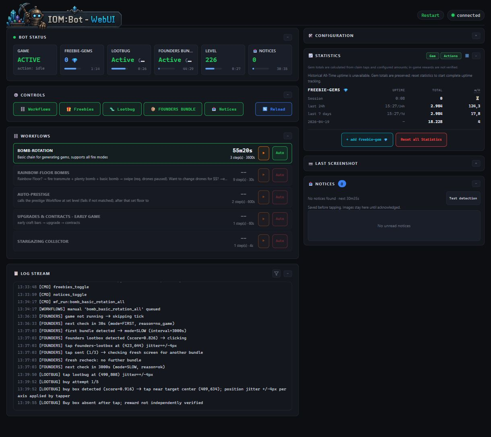
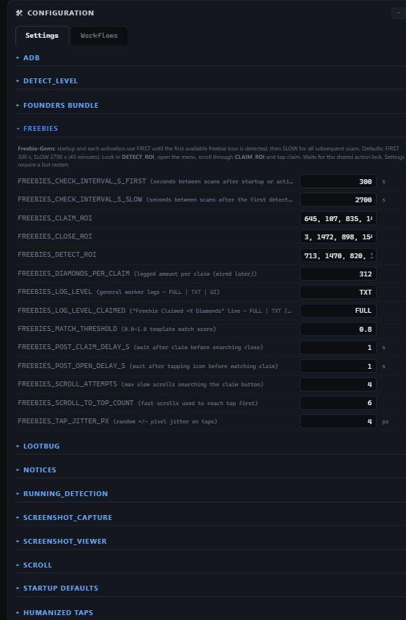
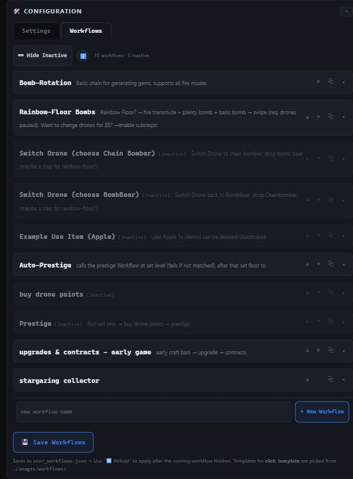
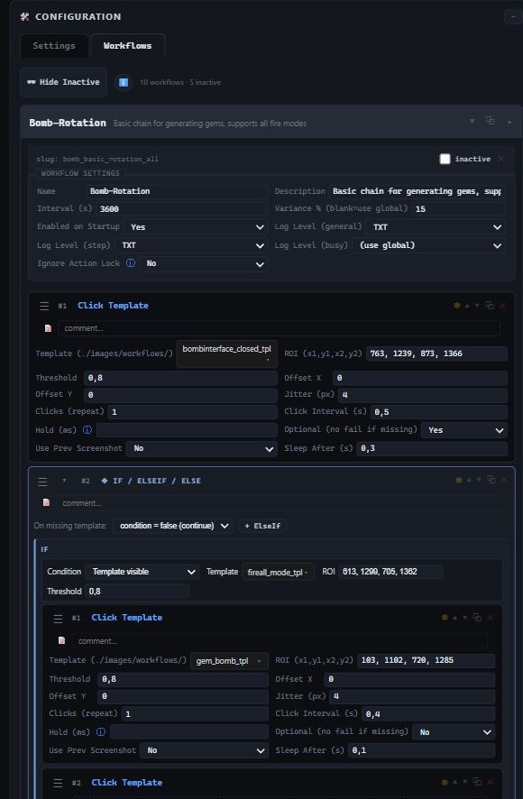
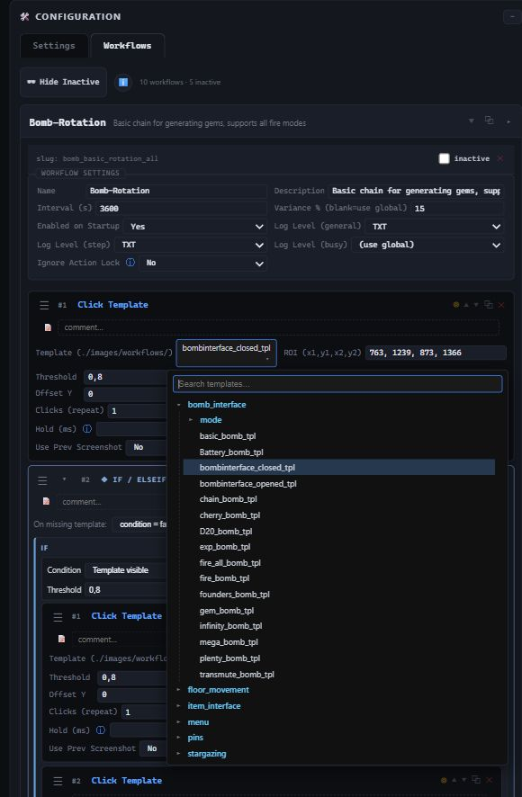
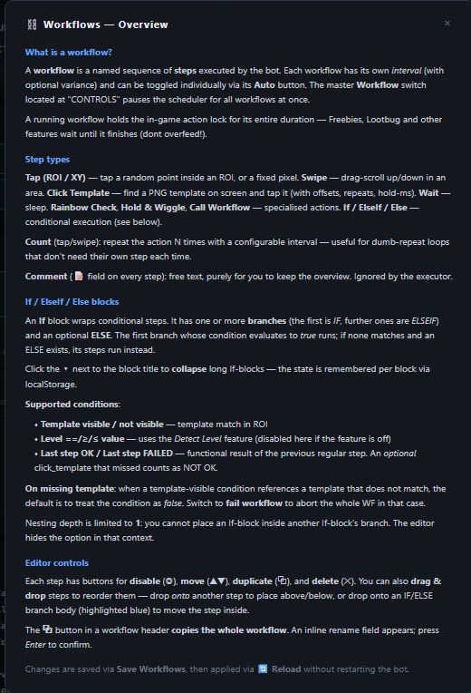
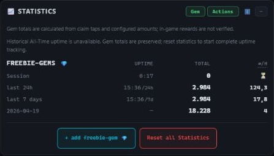
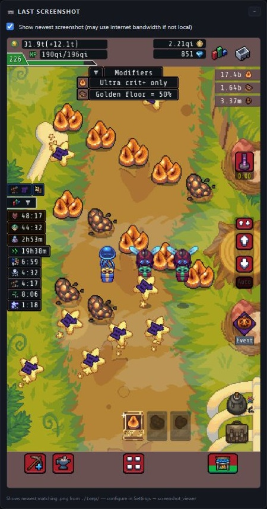
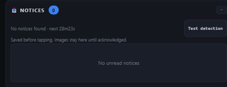

<p align="center">
  
</p>

# Idle Obelisk Miner Bot

Automate **Idle Obelisk Miner** with Python, ADB and a browser dashboard. Collect Freebies, handle Lootbugs and Founders Bundles, save game notices, and build custom workflows with visual steps and conditions.


The bot uses Android screenshots, fixed screen regions and OpenCV template matching. It requires no root, overlay or OCR library. MEmu and MuMu are the primary emulator targets.

## Contents

- [Features](#features)
- [Dashboard tour](#dashboard-tour)
- [Configuration: Settings](#configuration-settings)
- [Configuration: Workflows](#configuration-workflows)
- [Statistics](#statistics)
- [Last Screenshot and Notices](#last-screenshot-and-notices)
- [Requirements](#requirements)
- [Getting started](#getting-started)
- [Saving, reloading and restarting](#saving-reloading-and-restarting)
- [Configuration files and backups](#configuration-files-and-backups)
- [ADB and multiple emulator instances](#adb-and-multiple-emulator-instances)
- [How it works](#how-it-works)
- [Troubleshooting](#troubleshooting)
- [Further documentation](#further-documentation)
- [Limitations and responsible use](#limitations-and-responsible-use)

## Features

| Feature | What it does |
| --- | --- |
| **Freebies** | Detects available Freebie icons, opens the menu, scrolls to the claim button, claims and closes the menu. Uses separate initial and long-term scan intervals. |
| **Lootbug** | Detects a Lootbug and taps the Buy box using the bonus selection remembered by the game. Retries obscured or still-visible Buy boxes within a configured limit. |
| **Founders Bundle** | Independently detects and taps Founders lootboxes, checking a fresh screenshot after each tap to handle consecutive bundles. Enable only if you own the bundle. |
| **Notices** | Saves an image of a supported game notice before dismissal, with a persistent inbox for review and acknowledgement. |
| **Level detection** | Recognizes levels 1–999 from digit templates and supplies level-based workflow conditions. |
| **Workflows** | Runs custom sequences automatically or on demand, with intervals, variance, image checks, branches and reusable subworkflows. |
| **Workflow editor** | Creates, duplicates, sorts and edits workflows in the browser, with comments, disabled steps, drag-and-drop and searchable template selection. |
| **Gem statistics** | Tracks estimated Freebie-Gems and active time for the session, rolling 24 hours, rolling seven days and all time. |
| **Live dashboard** | Provides feature switches, scan countdowns, workflow controls, log filtering and a last-screenshot viewer, including access from trusted LAN devices. |
| **Input and connection settings** | Configures ADB discovery, fallback ports, drag scrolling, tap duration variation and position jitter. |

Screenshots below show a running local installation. Workflow names, enabled features, counters and settings are examples from that installation, not factory defaults.

## Dashboard tour



### Bot Status

Tiles show game detection, the current action-lock state, estimated Freebie-Gems, Lootbug and Founders action counts, the detected level and unread notices.

Freebie, Lootbug, Founders, Level and Notices scans have progress bars and countdowns. **Off** means disabled, **Ready** means due and **Setup** identifies a level-detection setup issue. Hover a countdown for scan ages or error details. Countdowns reflect actual schedules, including applicable variance and retries; they do not predict reward availability.

### Controls

| Control | Effect |
| --- | --- |
| **Workflows** | Master scheduler switch. OFF blocks manual requests, clears queued manual runs and cooperatively cancels a running workflow at execution boundaries. |
| **Freebies** | Enables or pauses collection and its statistics tracking. |
| **Lootbug** | Enables or pauses detection and the bounded Buy-box flow. |
| **FOUNDERS BUNDLE** | Enables or pauses the independent Founders worker. |
| **Notices** | Enables or pauses automatic saving and dismissal. The saved inbox remains available while OFF. |
| **Reload** | Requests application of saved workflow definitions after the current execution finishes. |
| **Restart** | Restarts the process to apply general settings and startup defaults. |

Feature switches affect the running session. Set their initial states separately in **Configuration → Settings → Startup Defaults**.

### Workflow panel

Each visible workflow shows its name, description, step count, interval and next-run information. **Auto** controls its scheduling; **▶** requests one execution. The master **Workflows** switch must be ON for manual requests too. Requests are rejected while another workflow is running.

An **inactive** workflow is excluded from the dashboard's scheduling list but remains in the editor and can be called by another workflow as a helper.

### Log Stream

Open the filter icon, enter a term and press Enter. Click a filter label to switch between inclusion and exclusion, or remove it with its close button. Matching is case-insensitive: any inclusion term may match, while an exclusion term hides matching messages. Filters synchronize between connected browsers.

Scroll up to inspect earlier messages; return to the bottom to resume automatic scrolling. Log routing is configurable: **FULL** writes to both file and dashboard, **TXT** to the file and **UI** to the dashboard.

## Configuration: Settings

Expand **Configuration** and select **Settings**. Sections open independently. Fields provide descriptions and units where available; hover truncated labels for their hints.



| Section | What to configure |
| --- | --- |
| **adb** | Preferred device, automatic connection, fallback ports, timeouts and retries. |
| **detect_level** | Detection enablement, digit ROI, interval, threshold and cache age. |
| **FOUNDERS BUNDLE** | Initial/long-term intervals, template and ROI, jitter, claim-chain limit and logging. |
| **freebies** | Initial/long-term intervals, icon/claim/close ROIs, scrolling, waits, estimated gems per claim and logging. |
| **lootbug** | Interval and variance, detection and Buy ROIs/templates, retry limits and Founders priority window. |
| **Notices** | Scheduling, masked frame templates, detection ROI, dismiss coordinates, retries and archive size limit. |
| **running_detection** | Search ROI, threshold and screenshot reuse for game detection. |
| **screenshot_capture** | Capture attempts, retry delays and diagnostics. |
| **screenshot_viewer** | Candidate PNG filenames in `temp/`; the newest valid matching image is displayed. |
| **scroll** | Default area, speed presets, drag durations, distances and edge padding. |
| **Startup Defaults** | Initial feature states when the process starts. |
| **Humanized Taps** | Default press duration, bounded duration variation and global position jitter. |
| **workflows** | Global variance, tap jitter, screenshot reuse, busy retries and logging. |

**Save Settings** validates and writes `config/user_settings.json`. **Restart** applies the saved values. Browser refresh and **Reload** do not apply general settings.

ROIs use **`x1, y1, x2, y2`**, in Android screen pixels. Thresholds are match scores from 0 to 1; higher means stricter, not a probability. Timings are seconds unless explicitly marked milliseconds.

### Feature-specific setup

- **Freebies:** the default initial interval is 300 seconds. The first available-icon detection switches to 2700 seconds, even if the subsequent claim fails. Restart or reactivation resets the phase. Set `FREEBIES_DIAMONDS_PER_CLAIM` to your expected reward; statistics use this amount.
- **Lootbug:** while automation is OFF, choose your bonuses in the game and confirm with **Buy**. The game remembers that selection. Enable **Remove lootbug gem confirmation** before enabling automation. The bot does not select bonuses. It checks a fresh image for Buy-box disappearance after a tap, retries within a limit and never automatically closes the dialog. Due or pending enabled Founders checks take priority.
- **Founders:** initial scans default to 180 seconds; a detection switches to 3000 seconds. A later regular scan without a bundle returns to fast 180-second checks until the next detection. Fresh rechecks handle up to three taps per cycle by default; remaining bundles use a short retry. Its switch and schedule are independent of Lootbug.
- **Notices:** supported frames are matched without reading their text. The default regular interval is 45 minutes with ±15% variance. Saving must succeed before dismissal. A full archive stops further saves and taps rather than deleting unread images.
- **Humanized Taps:** defaults are 100 ms with ±30% duration variation. Explicit workflow hold durations remain exact. Feature/step jitter can override global position jitter. Variation does not guarantee undetectable automation.

The visibility fields `gem_statistics_enabled` and `screenshot_visible` exposed under Startup Defaults are not consistently applied by the current override loader. Use the dashboard panel controls rather than relying on these fields for visibility after restart.

## Configuration: Workflows

Select **Workflows** inside Configuration to manage definitions, including inactive helpers.



### Create and edit

1. Enter a name in **new workflow name** and select **+ New Workflow**, or duplicate an existing workflow with **⧉**.
2. Expand its header. Set name, description, interval, optional variance and **Enabled on Startup**.
3. Add steps, choose templates and enter coordinates, thresholds and waits.
4. Reorder with drag-and-drop or arrows. Add comments and temporarily disable steps with **◎**.
5. Select **Save Workflows**, then **Reload**. Check the reload status before relying on the new definition.



Blank per-workflow variance uses the global setting. **Inactive** excludes a definition from regular scheduling; **Hide Inactive** only filters the editor list. Header arrows change workflow order. Both workflows and individual steps have duplicate controls; steps can also be moved between branches.

### Available step types

| Step | Purpose |
| --- | --- |
| **Tap (random in ROI)** | Random point in a rectangle, with repeats, interval, jitter and hold duration. |
| **Tap (fixed XY)** | Specified coordinate, with optional jitter, repeats and hold duration. |
| **Swipe / Scroll** | Drag gesture with area, speed/duration/distance options and repeats. |
| **Click Template** | Image match and tap, with offsets, repeated clicks and press duration. |
| **Click Rotating Template** | Rotated image matching with rotation, masking and downscale options. |
| **Wait (Sleep)** | Configured pause. |
| **Rainbow Floor Check** | Checks color distribution within an ROI for a Rainbow Floor. |
| **Call Workflow** | Runs another workflow inline, including inactive helpers; failure propagates to the caller. |
| **Hold & Wiggle** | Chained drag movements within an ROI for a configured duration. |
| **If / ElseIf / Else** | Runs the first matching branch, or Else if none matches. |

**Sleep After** adds a delay after a step. Explicit **Hold (ms)** overrides the global duration, including `0` for a plain tap. Keep sequences manageable: a normal workflow holds the shared game-action lock throughout execution, so other features wait.

**Ignore Action Lock** is an advanced exception for tiny, defensively checked workflows. It permits interleaving with feature actions and can disrupt them. It does not interrupt another running workflow.

### Conditions and templates

Conditions test template visibility/absence, compare the detected level (`==`, `>=`, `<=`), or inspect the previous regular step's result. Level conditions require level detection. The editor supports one If-block level, without another If block inside a branch.

For a template-visible condition, a missing match can mean **condition = false (continue)** or **fail workflow (abort)**. For template clicks, **Optional** permits a missing match, not an ADB input failure. A skipped optional match still counts as unsuccessful for a later **Last step** condition.



The picker browses `images/workflows/` and supports search. Templates, ROIs and Android resolution must agree. **Use Prev Screenshot** reuses a frame according to the step's capture rules; only use it when that frame still represents the expected screen.

Built-in definitions include bomb rotation, Rainbow Floor bombs, prestige, drone switching and upgrades/contracts. Local definitions replace these defaults, so installations can differ. Review sequences against your current game layout before enabling them.

<details>
<summary>Built-in workflow help</summary>

The information icon beside the list opens a guide to steps, conditions and editor controls.



</details>

## Statistics



Statistics estimate Freebie-Gems from successful claim inputs and the configured amount per claim. They do not read the actual game balance or independently confirm rewards.

| Row or column | Meaning |
| --- | --- |
| **Session** | Gems and active time since process start or statistics reset. |
| **last 24h / last 7 days** | Rolling wall-clock windows with hourly buckets; available after 24 hours / seven days from the period's first activation. |
| **Date / All-Time** | Cumulative totals since the period began, preserved across restarts and pruning of old hourly buckets. |
| **Uptime** | Time while Freebies is enabled, including searching and waiting. Disabled and offline periods are excluded. |
| **Total** | Estimated gems for the row. |
| **⌀/h** | Click to switch between wall-clock and active-uptime averages. Session always uses active session time. |

Averages require at least one hour of their reference time. Hover an hourglass for availability details. Legacy files may preserve gems while showing unavailable historical All-Time uptime.

**Gem** and **Actions** control panel sections; the information icon opens the guide. **+ add freebie-gem** records one configured claim amount without game input or a cooldown change, and requires active Freebies. **Reset all Statistics** clears history and counters.

Freebies OFF pauses uptime and claim recording and shows **Freebies inactive**. Wall-clock windows keep aging. Restart clears session values while preserving saved history.

## Last Screenshot and Notices

### Last Screenshot

Expand the panel and enable **Show newest screenshot** to view an existing cached image. It refreshes every five seconds; clicking it refreshes manually. The viewer does not request a new Android capture.



Configure candidate filenames under **Settings → screenshot_viewer**. An older last successful image may remain available when captures fail, so this viewer alone does not prove the game is still active.

### Notices inbox



The inbox shows saved notices, unread count and scan information. This example is empty. When populated, it lists images oldest first: **Enlarge** opens a preview and **Tap to delete** acknowledges and deletes the selected saved image. **Show more** loads further batches.

**Test detection** uses active templates and a fresh-enough cache, or captures a new screenshot if needed. It does not dismiss, archive or enable automation. Acknowledging an image also sends no game input.

Images survive browser and bot restarts until acknowledged. They live in `temp/notices/`; cleaning that directory deletes unread images too. An unchanged notice is not blindly archived and tapped repeatedly; visually identical consecutive notices may need manual dismissal.

## Requirements

- **Windows** with Python **3.10+**. Python 3.10–3.13 is the existing setup recommendation; this does not imply every interpreter/package combination has been tested.
- **ADB** from the emulator or on `PATH`.
- Idle Obelisk Miner in an Android emulator; primary targets are **MEmu Android 9** and **MuMu Android 12**.
- Packages from [`requirements.txt`](requirements.txt), including Flask, Flask-SocketIO, OpenCV, Pillow and tray integration.
- A modern browser. The Socket.IO client loads from an external CDN.

**Set the game language to English.** Templates depend on the game's visual appearance.

**Current default ROIs target a 900 × 1600 portrait Android screenshot.** Check actual capture dimensions, not just emulator window size or device-profile labels. Landscape 1600 × 900 and other resolutions require matching ROIs/templates; there is no automatic adaptation. Earlier README orientation guidance was inconsistent.

Other devices or renderers may require calibration. The existing setup recommends DirectX for MEmu and Vulkan for MuMu; verify matching quality on your installation.

## Getting started

1. Start the emulator and game in English. Confirm Android capture dimensions and the ADB device address.
2. Put the project in a writable directory. Discovery checks emulator paths, `adb.exe` in the project's parent directory and finally `PATH`.
3. Install dependencies:

   ```powershell
   py -m pip install -r requirements.txt
   ```

4. Optionally run `TEST-ENVIRONMENT.bat` to check dependencies and ADB. It performs imports, can contact ADB and writes temporary files; it is not a read-only regression test. `INSTALL-ENVIRONMENT.bat` installs packages.
5. Run `StartWebUI.vbs` or `StartWebUI.bat` for tray operation. For a console session:

   ```powershell
   python main.py
   ```

6. Open **http://localhost:6001**. From another trusted LAN device, open **http://HOST-LAN-IP:6001**, replacing `HOST-LAN-IP` with the bot computer's address. A phone's `localhost` refers to the phone itself.
7. Review Settings, especially ADB, ROIs and Startup Defaults. Save and restart for general settings; review workflow definitions before enabling automation.

The tray menu provides the WebUI, logs, restart and exit. A console session supports another port, for example `python main.py 7000`.

Starting the process starts the bot backend too. Saved startup defaults and workflows can trigger immediate game actions; the dashboard is not a separate preview-only mode.

### LAN access

The server binds to `0.0.0.0` and restricts clients to local/LAN addresses by default. Allow its port through Windows Firewall on your trusted private network if needed.

There is **no user authentication**: trusted LAN clients can control the bot. HTTP and Socket.IO check origins, including scheme, host and port. Public exposure and reverse proxies need separate access controls. `OBELISKBOT_ALLOW_PUBLIC=1` disables the IP restriction only; it does not add authentication or disable origin checks, and is not required for normal LAN use.

## Saving, reloading and restarting

| Change | Save with | Apply with |
| --- | --- | --- |
| General settings, ROIs, timing or Startup Defaults | **Save Settings** | **Restart** the process. |
| Workflow steps, names, ordering or definitions | **Save Workflows** | **Reload**, after the running workflow and its subworkflows finish. |
| Runtime feature switches or per-workflow Auto | Dashboard controls | Current session; configure startup behavior separately. |
| Browser display/filter controls | Panel controls | No process restart. |

Validation reports invalid values. Reload distinguishes pending, applied and error states; failure retains the active definitions. Reload preserves runtime flags and counters for surviving slugs, so changing **Enabled on Startup** does not replace current Auto state.

## Configuration files and backups

| File or directory | Purpose |
| --- | --- |
| `config/settings.py` | Central defaults, followed by local overrides at import. |
| `config/user_settings.json` | Local settings saved through the WebUI. |
| `config/config_workflows.py` | Built-in workflows used when the local workflow file is missing. |
| `config/user_workflows.json` | Complete local workflow collection, replacing defaults without merging. An empty collection means no workflows. |
| `gem_statistics.json` | Persistent estimated gems, uptime and rolling buckets. |
| `temp/notices/` | Notice images and dismissal bookkeeping; preserve during temporary-file cleanup. |
| `config/web_secret.json` | Automatically generated per-installation Flask signing key. Keep private. |
| `bot.log` | Rotating application log. |

Settings/workflow saves use validation and atomic JSON writes. Concurrent browser edits are not merged: the last successful whole-document save wins. Back up settings, workflows, statistics and unread notices before moving installations. JSON files, logs and temporary captures are excluded from Git; committing the source does not back up your local setup.

## ADB and multiple emulator instances

The bot tries **DEVICE**, then **ADB_SCAN_PORTS** if automatic connection is enabled and the preferred address is unavailable. Logs show the selected executable and device. With several instances, verify the selected address before enabling automation. Fallback scanning discovers a connection; it does not coordinate multiple devices.

Use your emulator's ADB executable or an ADB on `PATH` to inspect connections:

```powershell
adb devices
adb connect 127.0.0.1:16384
```

The port is an example; use your instance's actual address. Save and restart after changing the preferred device or fallback ports.

## How it works

The browser sends HTTP/Socket.IO commands to Flask. `bot_app.py` processes the queue; feature workers and the workflow scheduler use `core/` helpers for screenshots, matching and input.

Game actions normally share a lock to avoid overlapping menu operations. Captures use isolated slots, device-bound ADB commands, PNG validation and atomic publication. Features enforce image-age limits; a failed forced capture does not return an old image as fallback. The browser viewer independently displays an available valid capture.

Template matching searches fixed ROIs, level detection assembles digit templates and Rainbow Floor checks use color distribution. These mechanisms do not adapt automatically to arbitrary resolutions or game languages.

## Troubleshooting

| Symptom | What to check |
| --- | --- |
| Dashboard cannot connect | Process, host, port, Socket.IO CDN availability and, for LAN clients, the host firewall. |
| Game not detected | Selected device, foreground screen, English language, resolution, detection ROI/template and capture errors. A capture failure can report the game as absent. |
| Feature ON but waiting | Countdown and logs: action-lock waits, game-detection retries or the long-term interval may explain it. |
| Lootbug dialog stays open | Remembered selection, confirmation setting, Buy ROI/template and bounded retry logs. The bot deliberately does not close it. |
| Manual workflow rejected | Enable the master switch and wait for the current workflow. Check rejection messages and lock waits. |
| Saved settings unchanged | Save Settings and restart. Reload applies workflows only. |
| Workflow edits have no effect | Save Workflows, Reload and check completion/errors. Enabled on Startup is separate from current Auto state. |
| Level conditions unavailable | Enable/configure level detection, save and restart; check digit ROI/templates. |
| Statistics grey or unavailable | Enable Freebies for tracking; averages/windows need sufficient time. Legacy uptime cannot be reconstructed. |
| Old or unavailable screenshot | Enable the viewer; check configured filenames and capture logs. The viewer does not capture a new frame. |
| Notice saving stops | Archive errors, size limit, captures and supported frame templates. Preserve unread images before cleanup. |

## Further documentation

- [Project context](docs/PROJECT_CONTEXT.md): architecture, feature behavior, known discrepancies and verification.
- [Reliability and LAN access](docs/RELIABILITY.md): action results, validation, reloads and origin checks.
- [Screenshot pipeline](docs/SCREENSHOTS.md): capture slots, cache rules and diagnostics.
- [Statistics](docs/STATISTICS.md): uptime, averages, persistence and migration.
- [Notices](docs/NOTICES.md): masked detection, scheduling, storage and acknowledgement.
- [Notice template guide](tools/CREATE_NOTICE_TEMPLATE.md): creating and sanitizing frame/mask pairs.

## Limitations and responsible use

A successful ADB command confirms input submission, not an in-game reward. Counters and configured gem estimates are not balance measurements. Lootbug's fresh Buy-box disappearance check is not independent reward verification. Real-game behavior depends on timing, layout, templates and the game version.

This unofficial project is not affiliated with the game developer. Use at your own risk and in accordance with the game's rules. Input variation does not guarantee protection from detection or account restrictions.
